# agentsdash

A dashboard for your coding agents (**Claude Code**, **Codex**): every session on one screen, the ones waiting for you in orange, answered with one click.

Put it on a tablet or an old phone next to the keyboard: your agents stay in sight while the monitor keeps your code.

<p>
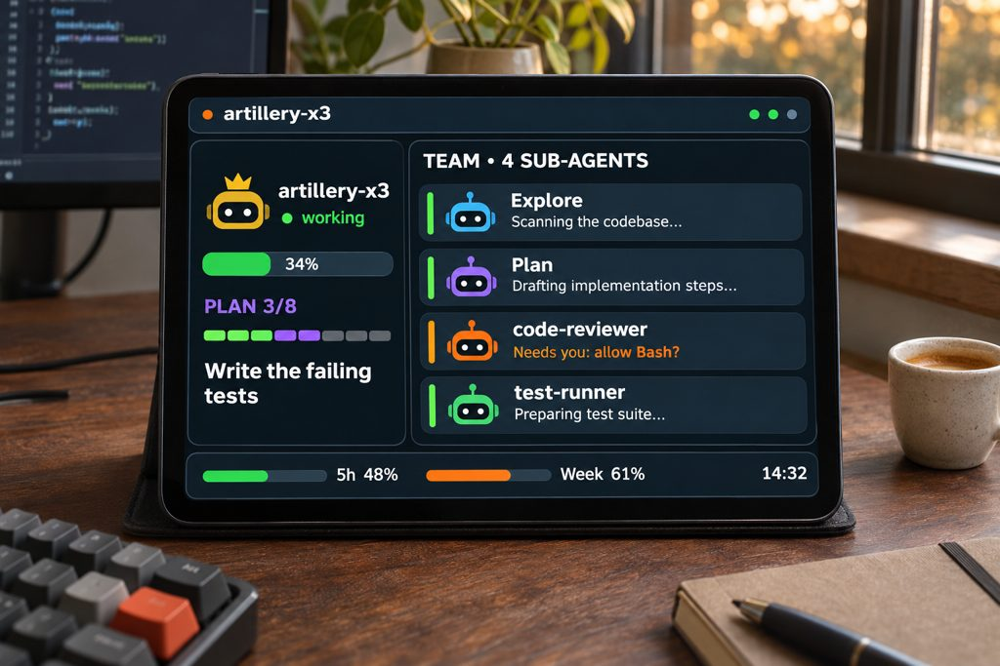
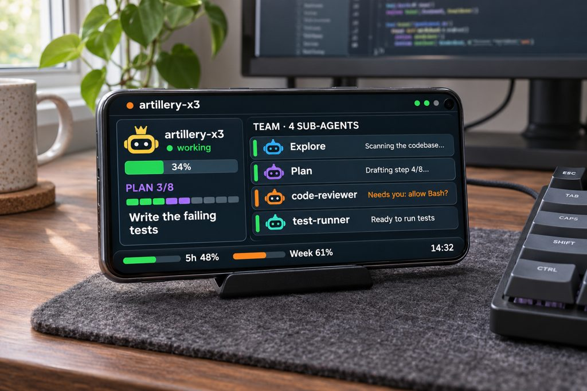
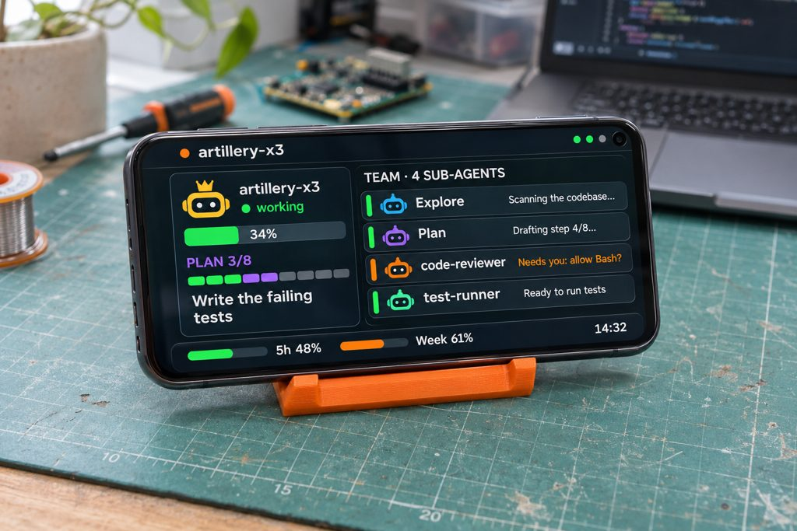
</p>

<sub>Illustrations of the idea. The real page is in the tour below.</sub>

## Goals

Run several agents at once without watching every terminal.

- **Keep your focus**: a question or a permission prompt turns its tile orange and beeps.
- **Answer without switching windows**: click an option, or Allow or Deny, right on the tile.
- **Know where every task stands**: the current step, the steps done and the ones left, for every session.
- **Follow your agents at work**: sub-agents, current action, context used, quota left.
- **Come back at the right moment**: the last reply of each agent is on its tile.

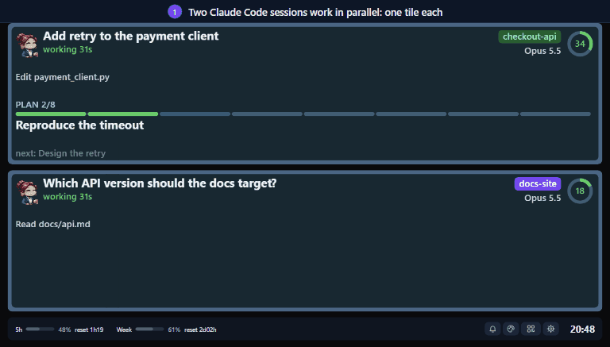

## On any screen

The page needs nothing but a browser: nothing to buy, nothing to flash.

| Screen | How | What it does |
|---|---|---|
| Second monitor | Open <http://127.0.0.1:8765/> in a window on that monitor, full screen with F11. | Everything: the grid, answers, settings, themes. |
| Phone or tablet | Click the phone button of the bottom bar, turn on phone access, scan the QR code on the same Wi-Fi. | One session per page, full screen, live. Read-only: answers stay on the PC. |
| ESP32 gadget | A relay in `~/.agentsdash/config.json` sends every event to it. | The same screen on real hardware, with a buzzer. See [Devices](#devices-optional). |

The phone page keeps the screen awake and says "Hub unreachable, retrying" when the PC sleeps.
Phone access is off by default; the QR code carries a token, and the link is plain http, so use it on a network you trust.
Details: [hub/README.md](hub/README.md#phone-pwa).

## Install

You install an adapter, never this repository: the adapter downloads the hub by itself on first use.

### Claude Code

Paste this in any session:

```text
Install agentsdash by following https://raw.githubusercontent.com/tfabien/agentsdash-claude/main/INSTALL.md
```

Details and manual install: [agentsdash-claude](https://github.com/tfabien/agentsdash-claude).

### Codex

Paste this in a Codex session:

```text
Install agentsdash for Codex by following https://raw.githubusercontent.com/tfabien/agentsdash-codex/main/INSTALL.md
```

Details and manual install: [agentsdash-codex](https://github.com/tfabien/agentsdash-codex) (first version: states, tools, questions, plan; no tokens yet).

### Then

Start a new session (hooks load when a session starts) and open **<http://127.0.0.1:8765/>**. Node.js 18 or later is needed.

Running the hub alone, updates and troubleshooting: [INSTALL.md](INSTALL.md).

## What you see

The page is a grid with one tile per session.

Each tile is drawn like the screen of the gadget, as vectors at the resolution of your display.
The screenshots below are taken from the real page, fed with made-up sessions (`node hub/tools/page_screenshots.mjs`).

### Sessions hub: all sessions at once

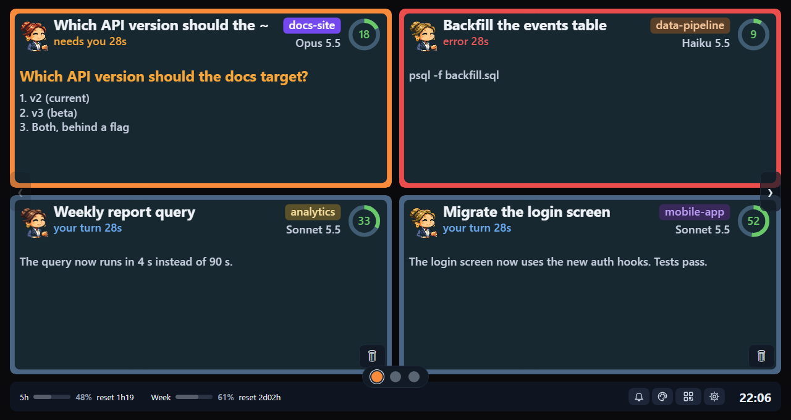

Open <http://127.0.0.1:8765/> for a grid with one tile per session (Claude Code CLI or desktop app), named after its title and colored by project.

- Orange tiles need you (the page beeps), red tiles have an error, and the frame of a tile pulses when something happens in its session.
- A session waiting for you for 5 minutes turns grey and moves to the end (the hub drops it after 10). The trash icon on a grey tile hides it until it works again or asks you something.
- A tap on a tile opens that session full screen, BACK returns. More sessions than tiles make pages: side arrows, dots (orange or red when a session on that page needs you or failed), a swipe or the left and right keys.
- The settings menu (gear) sets the tiles per page (Auto fits the window, 1 shows one session at a time), the beeps, the pulse and the grey-out. The hub keeps them for every page.
- The hub keeps 24 sessions by default: set `"max_sessions"` (up to 32) in `~/.agentsdash/config.json` to change it.

### Plans: see and follow the progress

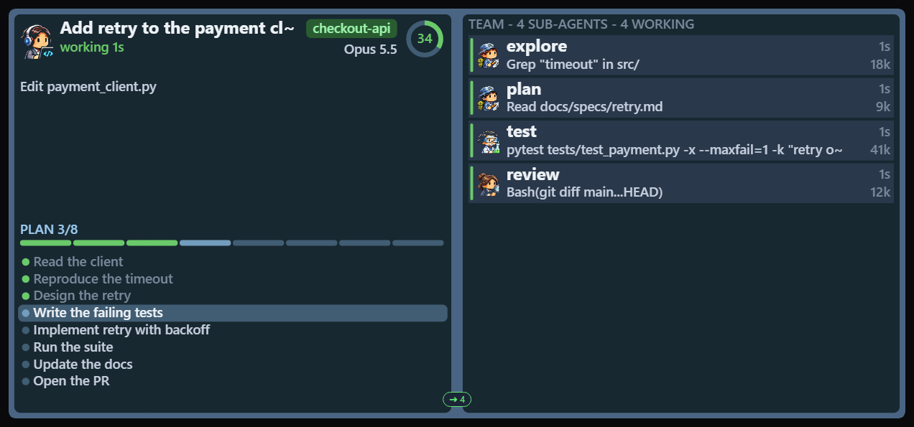

- Plan progress built from the task list of the session (`TaskCreate`/`TaskUpdate`, `TodoWrite`, the desktop `update_plan`): segmented bar, current step and next step. Steps running in parallel each pulse.
- Context fill ring next to the project badge (green under 60 %, orange 60 to 79 %, red from 80 %).

### Questions and permissions: answer from the page

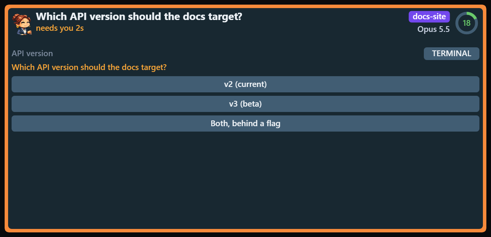

- A pending `AskUserQuestion` shows the question and one button per option. The session turns orange and the page beeps.
- A click on an option sends it to the agent. A multi choice question has a SEND button, and several questions come one after the other.
- TERMINAL hands the question back to the terminal or the app. Answering there works too: the tile drops its buttons.
- Free text answers are not on the page yet: type them in the terminal.

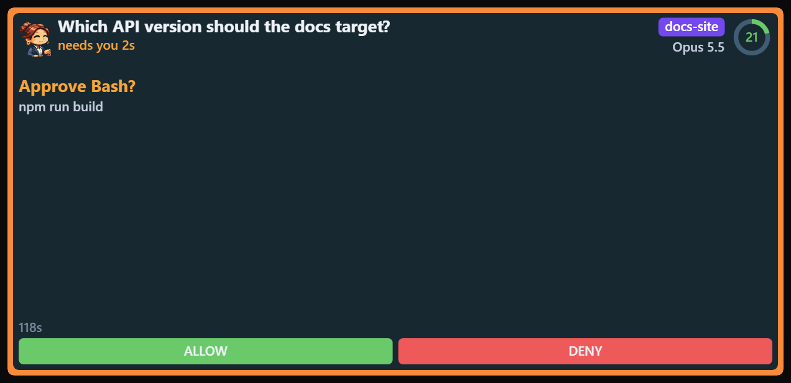

- A permission prompt shows the command with ALLOW and DENY. A click answers the agent, and the countdown says how long the page holds it before the terminal prompt asks as usual.
- Setting "Full screen on a question" (settings menu) opens the session that asks full screen, then returns to the grid once you answered.
- Click the speaker icon (bottom bar) to switch the beeps between `all`, `ask` (needs you only, the default) and `off`. The choice is kept by the hub, so every open page follows it.

### Sub-agents: see and follow them, click for the detail

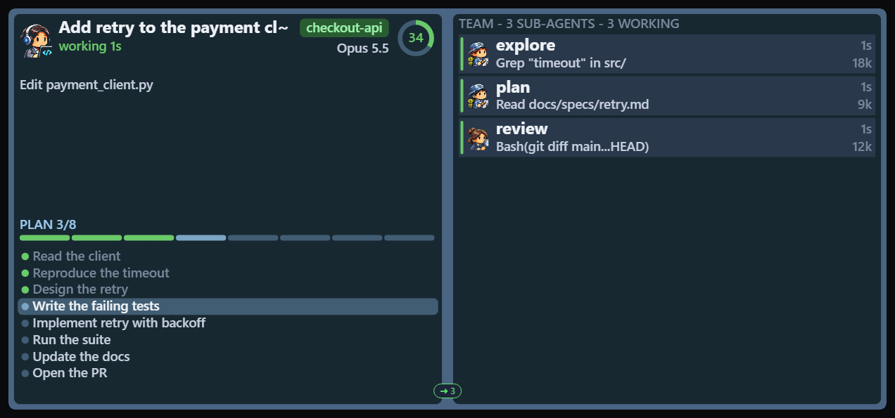

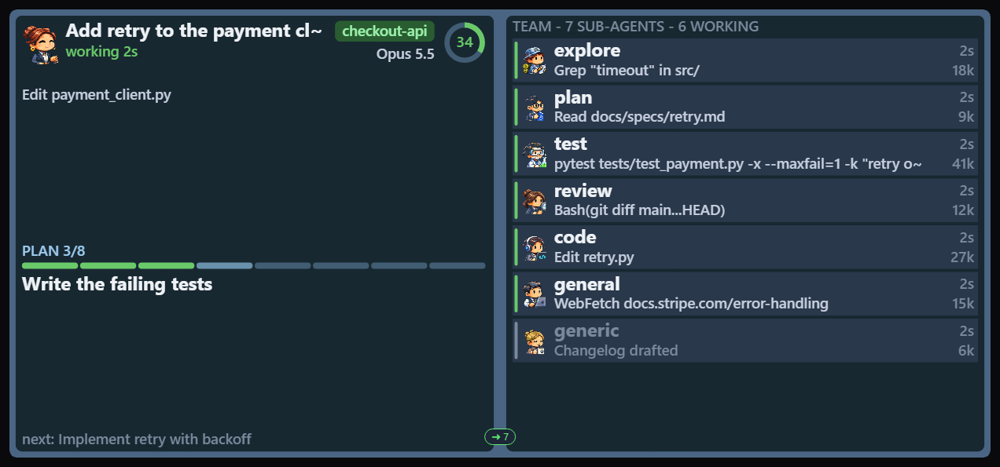

- One row per sub-agent: role robot (lead, general, explore, plan, review, test, code, generic), name, current action, tokens, age.
- 1 to 4 sub-agents get large rows, 5 to 7 compact rows, 8 or more show 6 rows and "+N more".
- Six states with their color: working (green), needs you (orange), error (red), your turn (grey-blue), waiting on sub-agents (blue), done (faint).
- Robots blink while working, and the state bar of an agent that needs you pulses orange.

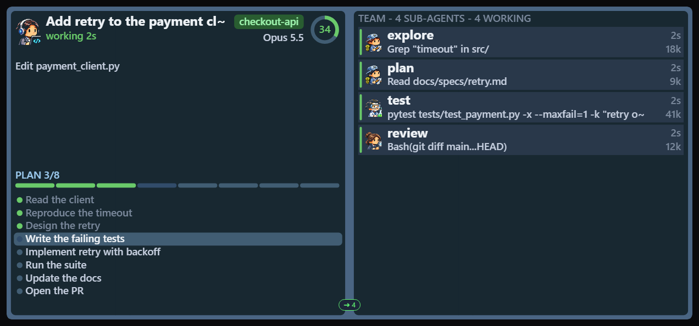

Click a sub-agent row: the panel shows its state, tokens and full command. BACK returns.

### Quotas

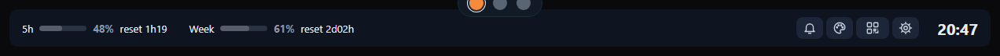

- 5-hour and weekly plan usage with reset time, colored by pace projection (green under 85 %, orange 85 to 100 %, red when you would run out before the reset). A script of the plugin polls them for the desktop app; a terminal status line can feed them too.
- The clock sits at the right of the bar. The page has no standby view (the big clock after 5 idle minutes): that stays on the ESP32 gadget.

### Themes

The palette button of the bar opens the theme dialog: install themes from the marketplace, apply one, edit its colors, tick the looks agents are drawn with, or save your own theme.

Project rules (settings menu) give the sessions of some folders their own badge color or icon pack, for example a red badge on `prod-*` folders.

A few of the themes of [agentsdash-themes](https://github.com/tfabien/agentsdash-themes), on the same four sessions:

| robot | cat-minimal |
|---|---|
| 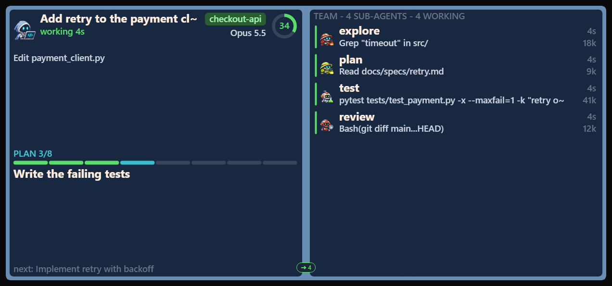 | 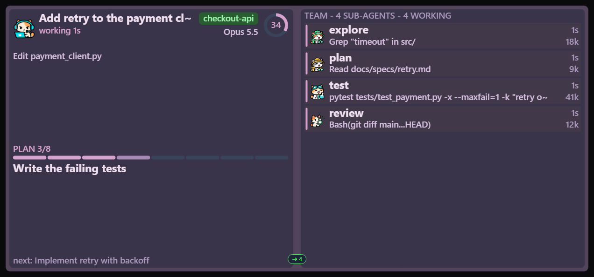 |
| **fantasy-rpg** | **office-retro** |
| 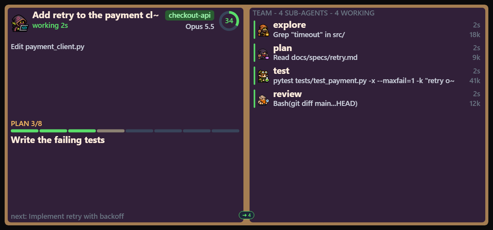 | 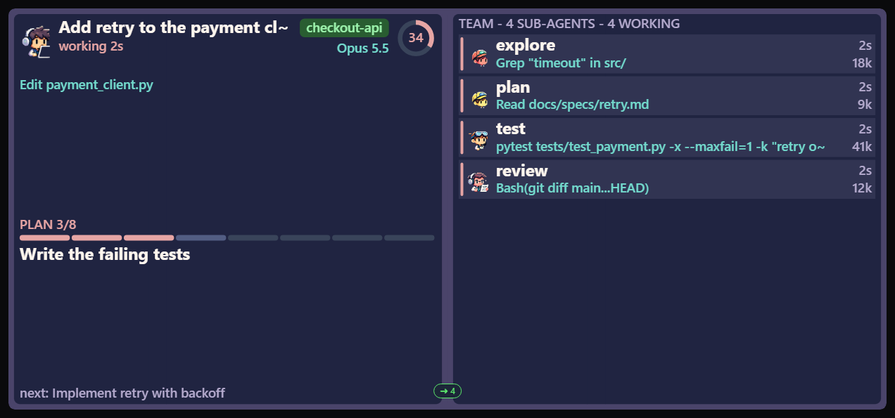 |

agentsdash ships one built-in theme (`line`); the hub downloads another at its first launch from [tfabien/agentsdash-themes](https://github.com/tfabien/agentsdash-themes), which holds the themes (robot, cat, lemmings, office, pirates, spelunky, yokai...), how to install them and the format to create your own.

Hub side (folders, project rules, marketplace): [docs/hub-themes.md](docs/hub-themes.md).

## How it works

```text
adapter (Claude Code hooks) --POST /event--> hub (Node.js) --SSE--> browser page
adapter (status line, quota poller) --POST /usage-->  |
                                             +--relay--> devices (optional): ESP32 gadget over Wi-Fi or USB
```

- An **adapter** (a repository of its own, for example [agentsdash-claude](https://github.com/tfabien/agentsdash-claude)) turns what an agent does into small JSON events (`POST /event`) and never slows the agent down. The contract is [docs/protocol.md](docs/protocol.md).
- The **hub** (`hub/`) starts with your first session, keeps the state of all sessions and serves the page. It listens on `127.0.0.1` only. Adapters post the plan quotas to it.
- A **device** (`devices/`) gets the same events from the hub and shows the same screen on real hardware.

Privacy: prompts, commands and file paths are shown on the page, on your computer only.

Set `AGENTSDASH_MASK=1` to send only tool names.

Options (host, sessions kept, relay) live in `~/.agentsdash/config.json` or in variables such as `AGENTSDASH_HOST`, see [hub/README.md](hub/README.md#configuration).

## Devices (optional)

The browser is the main way to use agentsdash.

A device is a bonus: a physical screen next to the keyboard that shows the same
thing, with its own buzzer.

The hub forwards every event to it (`relay` in `~/.agentsdash/config.json`), so page and device always agree.

| Device | State | Link |
|---|---|---|
| ESP32 + the touchscreen of an Artillery X3 3D printer (TJC 4.3", 480x272) | works, Wi-Fi relay tested, USB relay written | [agentsdash-device-artillery-x3](https://github.com/tfabien/agentsdash-device-artillery-x3) |
| A phone or a tablet (iPhone, Android) as a PWA | built into the hub (`/phone`): pair with a QR code on the same Wi-Fi, read-only | [On any screen](#on-any-screen), notes in [agentsdash-device-phone](https://github.com/tfabien/agentsdash-device-phone) |

More devices are welcome: [devices/README.md](devices/README.md) says what a device receives and how to add one.

## Repository

```text
hub/                       the core: server, model, web page, relays, terminal view (runs alone, released as a tarball)
devices/                   how to add an external screen (each device has its own repository)
docs/                      protocol and device protocol ([protocol.md](docs/protocol.md), [device-protocol.md](docs/device-protocol.md)), theme notes, specs, plans, README images
INSTALL.md                 running the hub, updates, troubleshooting

Other repositories: `agentsdash-claude` (Claude Code adapter), `agentsdash-codex` (Codex adapter), `agentsdash-themes` (themes and icon packs), `agentsdash-device-artillery-x3` (ESP32 gadget), `agentsdash-device-phone` (phone PWA).
```

Tests (no hardware): `node --test hub/test/*.test.mjs`.

Docs: [hub/README.md](hub/README.md) (hub, configuration, API, relays).

## TODO (known and not fixed)

Every item is an issue in the repository it belongs to; the maintainer follows them on a private GitHub Project board.

Core ([issues](https://github.com/tfabien/agentsdash/issues)):

- **One screen component for the page and the device** ([#3](https://github.com/tfabien/agentsdash/issues/3)).
- **Answer an `AskUserQuestion` from the screen** ([#75](https://github.com/tfabien/agentsdash/issues/75)): option buttons work on the hub page; free text, the phone page and the device are still missing, and a real session check is pending.
- **Reliable usage and quotas** ([#6](https://github.com/tfabien/agentsdash/issues/6)): the usage endpoint returns 429 and numbers can be stale.
- **Adapters never fetch a newer core** ([#57](https://github.com/tfabien/agentsdash/issues/57)).
- **The page does not follow the session that has the focus in the agent** ([#59](https://github.com/tfabien/agentsdash/issues/59)).
- **Tap a step of the plan bar to preview it** ([#60](https://github.com/tfabien/agentsdash/issues/60)).
- Smaller: recorded events copied by hand between repositories ([#58](https://github.com/tfabien/agentsdash/issues/58)), minor items of the hub review ([#62](https://github.com/tfabien/agentsdash/issues/62)), a GitHub organization ([#63](https://github.com/tfabien/agentsdash/issues/63)), a stub for the plugin under the first name ([#64](https://github.com/tfabien/agentsdash/issues/64)).

Codex adapter ([agentsdash-codex](https://github.com/tfabien/agentsdash-codex/issues)):

- **Tokens, context and session title** from the Codex transcript ([#1](https://github.com/tfabien/agentsdash-codex/issues/1)).
- **Run the hooks in a real Codex and test the plugin form** ([#2](https://github.com/tfabien/agentsdash-codex/issues/2)).
- **Core download behind a proxy** ([#3](https://github.com/tfabien/agentsdash-codex/issues/3)).

Claude Code adapter ([agentsdash-claude](https://github.com/tfabien/agentsdash-claude/issues)):

- **Send the `error` state** the page already draws ([#2](https://github.com/tfabien/agentsdash-claude/issues/2)).
- **Core download behind a proxy** ([#1](https://github.com/tfabien/agentsdash-claude/issues/1)).
- **Prompts: a staleness hint on the screen** and a rule-following report ([#3](https://github.com/tfabien/agentsdash-claude/issues/3)).

Devices:

- **Phone as a device** (a PWA for iPhone and Android): the first version works on the home Wi-Fi over plain http; HTTPS, a service worker and use outside the home network are open in [agentsdash-device-phone](https://github.com/tfabien/agentsdash-device-phone) ([#1](https://github.com/tfabien/agentsdash-device-phone/issues/1)).
- **ESP32 gadget:** USB relay test on hardware ([#1](https://github.com/tfabien/agentsdash-device-artillery-x3/issues/1)), a screen that is easy to buy ([#2](https://github.com/tfabien/agentsdash-device-artillery-x3/issues/2)), clock settings ([#3](https://github.com/tfabien/agentsdash-device-artillery-x3/issues/3)), the default OTA password ([#4](https://github.com/tfabien/agentsdash-device-artillery-x3/issues/4)). More in its [TODO](https://github.com/tfabien/agentsdash-device-artillery-x3#todo).
