# agentsdash

One page that shows what your coding agents are doing.

Every session, every sub-agent, how far each plan has come, and which agent is waiting for you.

It works with **Claude Code** and **Codex**, in your browser, with nothing to buy and nothing to flash.

## Install

You install an adapter, never this repository: the adapter downloads the hub by itself on first use.

### Claude Code

Paste this in any session:

```text
Install agentsdash by following https://raw.githubusercontent.com/tfabien/agentsdash-claude/main/INSTALL.md
```

Details and manual install: [agentsdash-claude](https://github.com/tfabien/agentsdash-claude).

### Codex

Paste this in a Codex session:

```text
Install agentsdash for Codex by following https://raw.githubusercontent.com/tfabien/agentsdash-codex/main/INSTALL.md
```

Details and manual install: [agentsdash-codex](https://github.com/tfabien/agentsdash-codex) (first version: states, tools, questions, plan; no tokens yet).

### Then

Start a new session (hooks load when a session starts) and open **<http://127.0.0.1:8765/>**. Node.js 18 or later is needed.

Running the hub alone, updates and troubleshooting: [INSTALL.md](INSTALL.md).

## Goals

Run several agents at once and stay productive, without watching every terminal.

1. **Keep your focus**: start your agents, work on something else, and let the page tell you when one needs you.

   A question or a permission prompt turns its tile orange and beeps, so no agent sits blocked for an hour without you noticing.

2. **Know where every task stands**: one glance gives, for each session, the step that runs now, the steps done and the ones left.

   No more scrolling a terminal to find out whether a plan is at step 2 or step 7.

3. **Follow your agents at work**: every session, its sub-agents, what each one is doing, how much context it has used and how much of your quota is left.

   Like a stand-up meeting of your agents, on one screen.

4. **Get your answers faster**: the last reply of each agent is on its tile, and a finished session says so.

   You come back to the right session at the right moment.

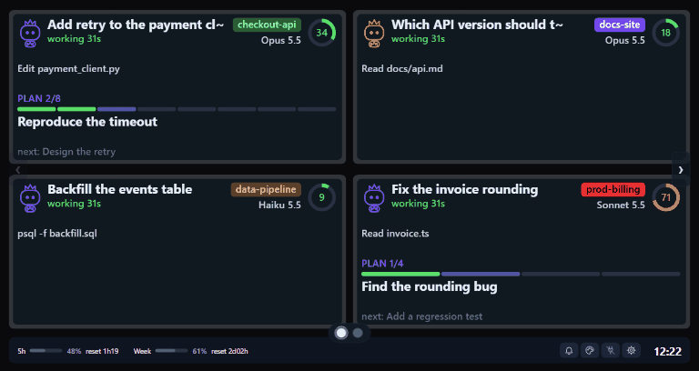

The hub in this repository is a small Node.js server that draws the screen **in your browser**, fed by adapters that watch your agents.

An external screen (an ESP32 gadget, a USB display) is a bonus, see [Devices](#devices-optional).

## What you see

The page is a grid with one tile per session.

Each tile is drawn like the screen of the gadget, as vectors at the resolution of your display.
The screenshots below are taken from the real page, fed with made-up sessions (`node hub/tools/page_screenshots.mjs`).

### Sessions hub: all sessions at once

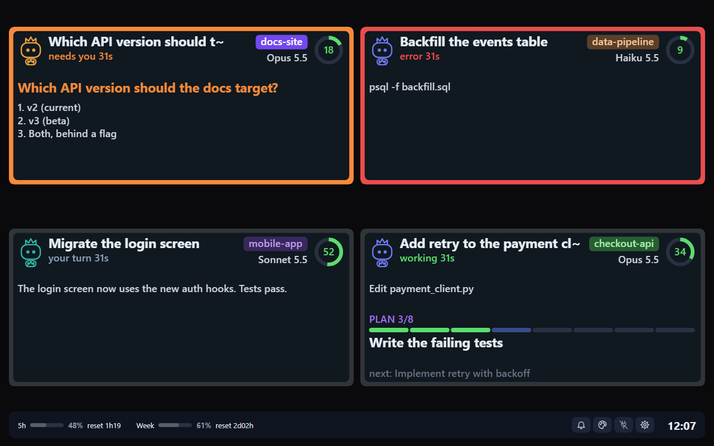

Open <http://127.0.0.1:8765/> for a grid with one tile per session (Claude Code CLI or desktop app), named after its title and colored by project.

- Orange tiles need you (the page beeps), red tiles have an error, and the frame of a tile pulses when something happens in its session.
- A session waiting for you for 5 minutes turns grey and moves to the end (the hub drops it after 10). The trash icon on a grey tile hides it until it works again or asks you something.
- A tap on a tile opens that session full screen, BACK returns. More sessions than tiles make pages: side arrows, dots (orange or red when a session on that page needs you or failed), a swipe or the left and right keys.
- The settings menu (gear) sets the tiles per page (Auto fits the window, 1 shows one session at a time), the beeps, the pulse and the grey-out. The hub keeps them for every page.
- The hub keeps 12 sessions by default: set `"max_sessions"` (up to 32) in `~/.agentsdash/config.json` to change it.

### Plans: see and follow the progress

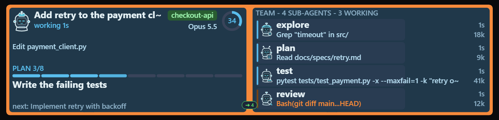

- Plan progress built from the task list of the session (`TaskCreate`/`TaskUpdate`, `TodoWrite`, the desktop `update_plan`): segmented bar, current step and next step. Steps running in parallel each pulse.
- Context fill ring next to the project badge (green under 60 %, orange 60 to 79 %, red from 80 %).

### Questions: display and notification

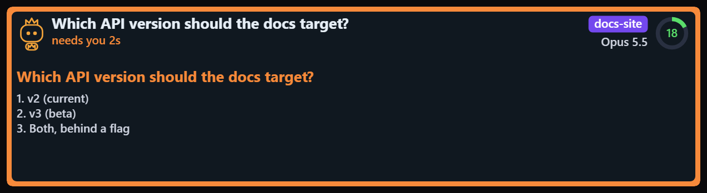

- A pending `AskUserQuestion` shows the question and its numbered options. The session turns orange and the page beeps.
- Permission prompts turn the session orange too.
- Click the speaker icon (bottom bar) to switch the beeps between `all`, `ask` (needs you only, the default) and `off`. The choice is kept by the hub, so every open page follows it.

### Sub-agents: see and follow them, click for the detail

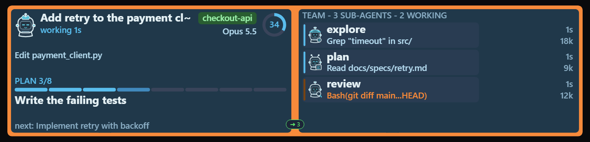

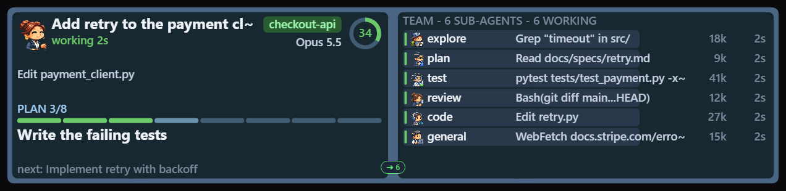

- One row per sub-agent: role robot (lead, general, explore, plan, review, test, code, generic), name, current action, tokens, age.
- 1 to 4 sub-agents get large rows, 5 to 7 compact rows, 8 or more show 6 rows and "+N more".
- Six states with their color: working (green), needs you (orange), error (red), your turn (grey-blue), waiting on sub-agents (blue), done (faint).
- Robots blink while working, and the state bar of an agent that needs you pulses orange.

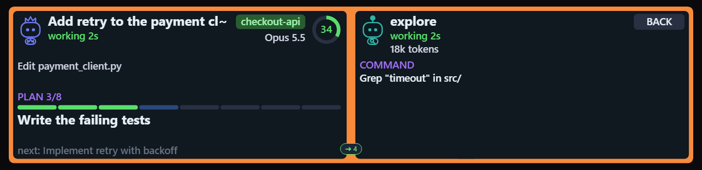

Click a sub-agent row: the panel shows its state, tokens and full command. BACK returns.

### Quotas

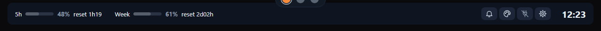

- 5-hour and weekly plan usage with reset time, colored by pace projection (green under 85 %, orange 85 to 100 %, red when you would run out before the reset). A script of the plugin polls them for the desktop app; a terminal status line can feed them too.
- The clock sits at the right of the bar. The page has no standby view (the big clock after 5 idle minutes): that stays on the ESP32 gadget.

### Themes

The palette button of the bar opens the theme dialog: install themes from the marketplace, apply one, edit its colors, tick the looks agents are drawn with, or save your own theme.

Project rules (settings menu) give the sessions of some folders their own badge color or icon pack, for example a red badge on `prod-*` folders.

A few of the themes of [agentsdash-themes](https://github.com/tfabien/agentsdash-themes), on the same four sessions:

| robot | cat-minimal |
|---|---|
| 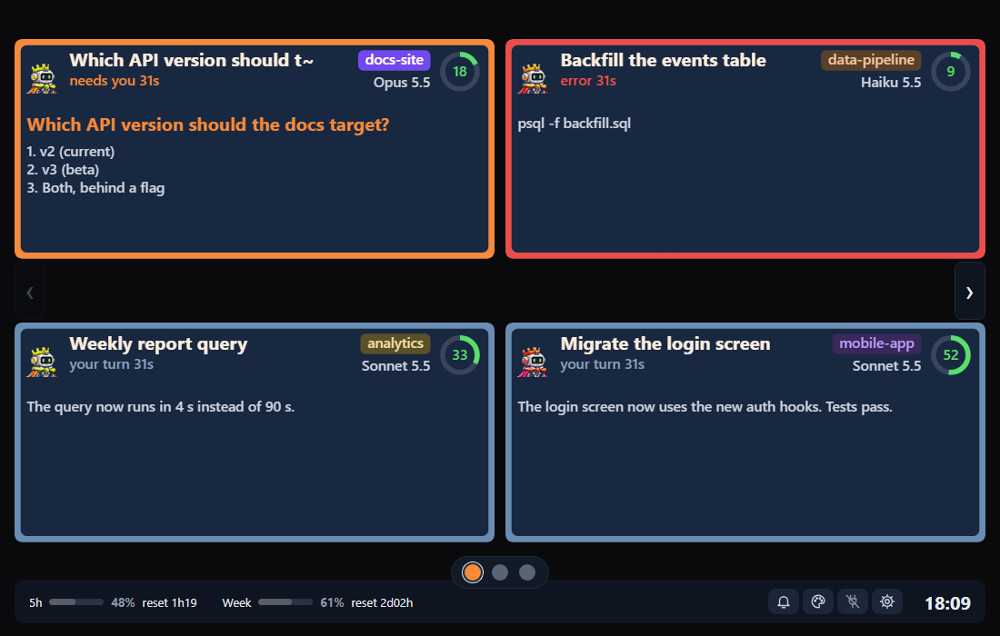 | 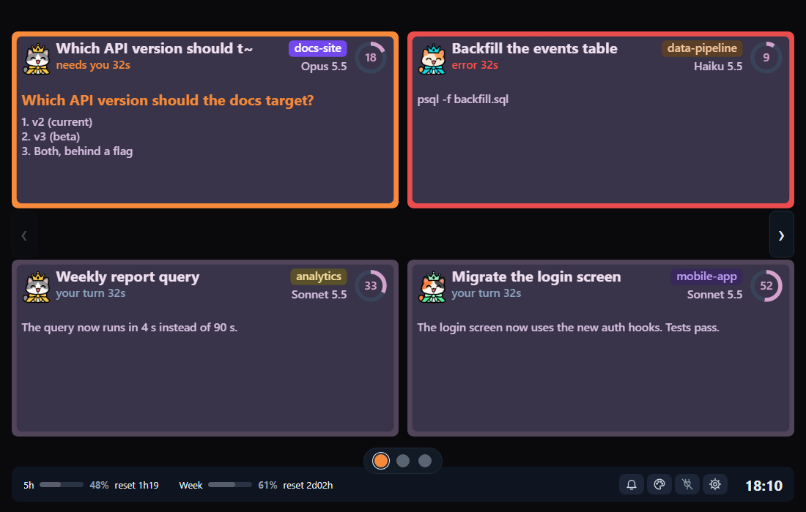 |
| **fantasy-rpg** | **office-retro** |
| 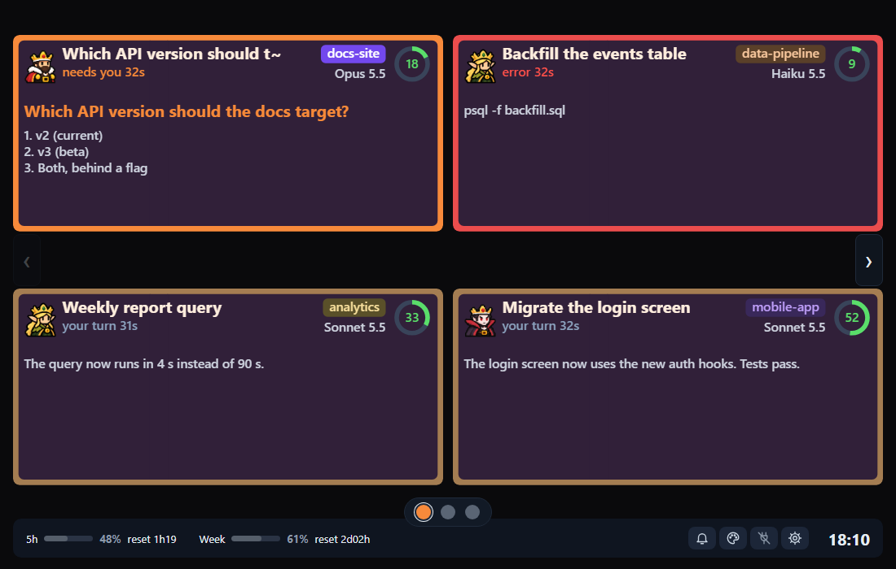 | 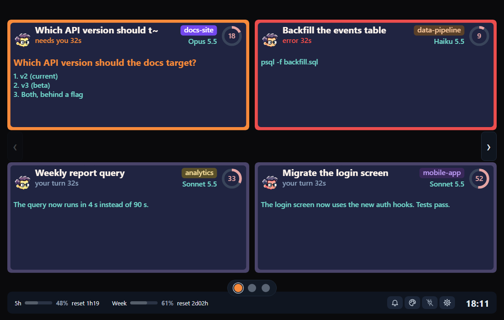 |

agentsdash ships no theme: the hub downloads one at its first launch from [tfabien/agentsdash-themes](https://github.com/tfabien/agentsdash-themes), which holds the themes (robot, cat, lemmings, office, pirates, spelunky, yokai...), how to install them and the format to create your own.

Hub side (folders, project rules, marketplace): [docs/hub-themes.md](docs/hub-themes.md).

## How it works

```text
adapter (Claude Code hooks) --POST /event--> hub (Node.js) --SSE--> browser page
adapter (status line, quota poller) --POST /usage-->  |
                                             +--relay--> devices (optional): ESP32 gadget over Wi-Fi or USB
```

- An **adapter** (a repository of its own, for example [agentsdash-claude](https://github.com/tfabien/agentsdash-claude)) turns what an agent does into small JSON events (`POST /event`) and never slows the agent down. The contract is [docs/protocol.md](docs/protocol.md).
- The **hub** (`hub/`) starts with your first session, keeps the state of all sessions and serves the page. It listens on `127.0.0.1` only. Adapters post the plan quotas to it.
- A **device** (`devices/`) gets the same events from the hub and shows the same screen on real hardware.

Privacy: prompts, commands and file paths are shown on the page, on your computer only.

Set `AGENTSDASH_MASK=1` to send only tool names.

Options (host, sessions kept, relay) live in `~/.agentsdash/config.json` or in variables such as `AGENTSDASH_HOST`, see [hub/README.md](hub/README.md#configuration).

## Devices (optional)

The browser is the main way to use agentsdash.

A device is a bonus: a physical screen next to the keyboard that shows the same
thing, with its own buzzer.

The hub forwards every event to it (`relay` in `~/.agentsdash/config.json`), so page and device always agree.

| Device | State | Link |
|---|---|---|
| ESP32 + the touchscreen of an Artillery X3 3D printer (TJC 4.3", 480x272) | works, Wi-Fi relay tested, USB relay written | [agentsdash-device-artillery-x3](https://github.com/tfabien/agentsdash-device-artillery-x3) |
| A phone (iPhone or Android) as a PWA | idea, nothing built yet | [agentsdash-device-phone](https://github.com/tfabien/agentsdash-device-phone) |

More devices are welcome: [devices/README.md](devices/README.md) says what a device receives and how to add one.

## Repository

```text
hub/                       the core: server, model, web page, relays, terminal view (runs alone, released as a tarball)
devices/                   how to add an external screen (each device has its own repository)
docs/                      protocol and device protocol ([protocol.md](docs/protocol.md), [device-protocol.md](docs/device-protocol.md)), theme notes, specs, plans, README images
INSTALL.md                 running the hub, updates, troubleshooting

Other repositories: `agentsdash-claude` (Claude Code adapter), `agentsdash-codex` (Codex adapter), `agentsdash-themes` (themes and icon packs), `agentsdash-device-artillery-x3` (ESP32 gadget), `agentsdash-device-phone` (phone PWA, idea).
```

Tests (no hardware): `node --test hub/test/*.test.mjs`.

Docs: [hub/README.md](hub/README.md) (hub, configuration, API, relays).

## TODO (known and not fixed)

Tracked as issues:

- **One screen component for the page and the device.** The sessions hub tiles are HTML (`hub_page.js`, logic in `hub_view.js`), the full page is still one canvas (`screen.js`) ([issue #3](https://github.com/tfabien/agentsdash/issues/3)).
- **Allow or deny a permission request from the screen.** A `PermissionRequest` hook can allow or deny, so the hook would wait for the hub ([issue #4](https://github.com/tfabien/agentsdash/issues/4)). A free choice among options needs another channel: no hook can inject an answer into a running `AskUserQuestion`.
- **Reliable usage and quotas.** The usage endpoint returns 429 (backoff 15 minutes), numbers can be stale, and the context estimate from transcripts assumes a 1M window ([issue #6](https://github.com/tfabien/agentsdash/issues/6)).
- **Phone as a device** (a PWA for iPhone and Android, with hub discovery): a project of its own, [agentsdash-device-phone](https://github.com/tfabien/agentsdash-device-phone) (idea and open questions, [issue #1](https://github.com/tfabien/agentsdash-device-phone/issues/1)).

Adapters:

- **Codex: tokens, context and session title.** They need the Codex transcript format ([agentsdash-codex](https://github.com/tfabien/agentsdash-codex)). The hooks were written from the documentation and have not run in a real Codex yet, and the plugin form (`.codex-plugin`) is untested.
- **Claude Code: the `error` state.** The page draws it, but no hook sends it yet (a failed tool or a stopped turn could).
- **Prompts: a staleness hint on the screen itself,** and a way to see how well sessions follow the rules.
- **The page does not follow the session that has the focus.** Today it picks the session itself (needs-you first) or by click.

The core and the repositories:

- **Downloads behind a proxy.** The adapters download the hub with `fetch`, which ignores `HTTP_PROXY`: on a work PC behind a proxy the first install needs `AGENTSDASH_CORE_DIR`.
- **Core updates.** An adapter keeps the core it found and only replaces a hub older than its minimum version: nothing fetches a newer release by itself.
- **Recorded events are copied by hand** between the adapters and `hub/test/fixtures/`. A check in CI would catch a stale copy.
- **A GitHub organization** for the repositories, if third parties start to contribute (the topics `agentsdash` group them for now).
- **A stub for the plugin under the project's first name** that tells its users to switch, planned and not made.

Smaller items:

- **Tap a step of the plan bar to preview it.** Needs the titles of all steps (today the plan fields carry only `done`, `total`, the current and the next step).
- **Raise the default of `max_sessions`** once the session list of the full page scrolls (12 rows overflow it today).
- **Minor items of the hub review:** `"constructor"` accepted as a state, 400 ms per hook when the hub cannot start (no backoff), the plan file lock can wait 2 s, the hub does not replay its state to a device that rebooted.

The TODO of the ESP32 gadget (USB relay test on hardware, clock settings, other boards) is in its repository: [agentsdash-device-artillery-x3](https://github.com/tfabien/agentsdash-device-artillery-x3#todo).
