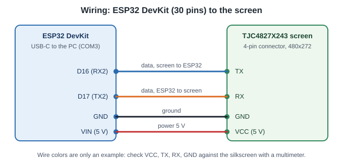

# ESP32 gadget with the screen of an Artillery X3

A physical copy of the agentsdash screen: the 4.3" touchscreen of an Artillery X3 3D printer, driven by an ESP32, with a buzzer.
It shows what the browser page shows, and it works on its own: it keeps the state of all sessions and draws the screen itself.
The screen was used because it was at hand; it is not sold on its own (see the [TODO](#todo)).

The hub forwards every event to it over Wi-Fi, so the gadget and the page always agree. You can also point the plugin straight at the
gadget (no hub, no page, no quota polling).

## Hardware

| Part | Role |
|---|---|
| Screen `TJC4827X243_011C` (TJC X2 series) | 4.3", 480x272, capacitive touch, buzzer. Taken from the printer, its original firmware was replaced by `screen-hmi/agent-gadget.tft`. |
| ESP32 DevKit (30 pins, USB-C, CH340) | Joins your Wi-Fi, serves an HTTP API, keeps the state of all agents, draws on the screen through a UART (9600 baud at power-up, then 115200). |

```text
hub --HTTP relay--> ESP32 --UART--> TJC screen (touch, buzzer)
```



Wiring: ESP32 `D16` <- screen TX, `D17` -> screen RX, `GND`, `VIN` (5 V) -> screen `VCC`. The 4-pin connector of the screen is
marked `VCC=5V`, `TX`, `RX`, `GND`: measure it with a multimeter, do not trust the wire colors.

## Set it up

1. **Flash the ESP32** with [PlatformIO](https://platformio.org/): `pio run -t upload` in `firmware/` (USB, automatic reset, no BOOT button).
2. **Flash the screen**: open `http://<ip>/tft` and upload `screen-hmi/agent-gadget.tft` (about 1 minute), or follow the editor steps in `screen-hmi/guide/`.
3. **Join the Wi-Fi setup network** `AgentGadget-XXXX` and enter your Wi-Fi at `http://192.168.4.1/config`. No code to edit; the credentials are kept in flash. To forget them, hold BOOT for 3 s at power-up.
4. **Point the hub at it**: in `~/.claude/agent-gadget.json`
   ```json
   { "host": "127.0.0.1:8765", "relay": { "mode": "http", "host": "<ip of the gadget>" } }
   ```
   The IP is shown on the screen while no agent is displayed. (`agent-gadget.local` does not resolve on every PC: use the IP.)
5. **Change `OTA_PASSWORD`** in `firmware/net.h` (default `agent-gadget`; it protects `/update` and `/tft`).
6. **Try it without real sessions**: `python scripts/scenario.py --host <ip>` fills the screen with 5 fake sessions and 12 sub-agents.

Updates: USB `pio run -t upload`, Wi-Fi `pio run -e esp32dev_ota -t upload --upload-port <ip>`, or the browser page `http://<ip>/update`
(firmware) and `http://<ip>/tft` (screen project). Do not send other requests to the gadget while `/tft` uploads (the hub's relay stays
quiet while the file `agent-gadget-tft.lock` exists in the temp folder).

## On the gadget

- Same views as the page: title bar with one dot per session, lead panel with plan and context, team rows, question in full width, standby clock, quota bar.
- Touch: tap a sub-agent row for its detail, tap the title bar for the session list (the trash icon of a row hides that session), tap the speaker icon to cycle the buzzer (`all`, `ask` = needs you only, `off`, kept in flash).
- Buzzer: two beeps when an agent starts to need you, one when a session waits for your turn (mode `all`).
- Standby: after 5 minutes without an active agent, an NTP clock (Europe/Paris), the date and a summary of idle sessions.

## Folder

```text
firmware/          ESP32 firmware (PlatformIO): core (model, net) and screen (display_hmi, layout, touch, hmi_uart)
screen-hmi/        the screen project (USART HMI): .HMI, compiled .tft, fonts, editor guide
hmi_bridge/        transparent USB <-> screen UART bridge (flash the screen from the editor)
hmi_probe/         baud and protocol probe of the screen
tools/             pictures, sprites and font metrics generators (Python)
assets/            generated pictures of the screen project
scripts/           scenario.py (fake team), hmi_* helper scripts through the bridge
tests/             API tests that drive a real gadget (GADGET_HOST), unit checks of the pictures
docs/              captured facts (touch)
ARCHITECTURE.md    layers, wire format, HTTP API, display interface
CLAUDE.md          technical notes for working on this device (hardware, screen protocol, pitfalls)
```

HTTP API and wire format: [ARCHITECTURE.md](ARCHITECTURE.md). Tests (a gadget flashed with a test build, `GADGET_HOST=<ip>`):
`python -m unittest discover -s tests`.

## TODO

- **Test the USB relay of the hub on the hardware (minor).** `relay: {"mode":"serial","port":"COM3"}`, `plugin/hub/relay_serial.mjs` and the firmware line reader (`firmware/esp32_agent_gadget.ino`, `netSerialLine` in `firmware/net.cpp`) are unit-tested with a fake port and the firmware is flashed, but nothing was tried over a real cable. To do: `npm install serialport` in `plugin/hub/`, then `GADGET_PORT=COM3 python -m unittest tests.test_serial_in`, then a real session in serial mode (one program owns COM3: release it with `POST /serial/release` before `pio upload`).
- **A screen that is easy to buy.** Support at least one common, cheap board with a screen (an ESP32 with a built-in TFT, an ESP32-S3 touch display) next to this one, with a shopping list. `firmware/display.h` already separates the UI from the screen backend; a new board would be a new folder under `devices/`.
- **Clock settings**: choose the timezone (Europe/Paris is hard-coded) and the 24 h or 12 h format from the `/config` page, kept in flash.
- Real photos of the device in the main README (the images there are screenshots of the page).
- Check `xstr` text without background (`sta=3`) and the readability of the three context colors on the real panel.
- Screen text is ASCII only: no accents until a font with them is added to the project.
- The original Artillery firmware was overwritten and cannot be restored from this repo.
- Default `OTA_PASSWORD` must be changed.
- `scripts/*.py` and `tests/*.py` still have some French docstrings: translate when touched.
